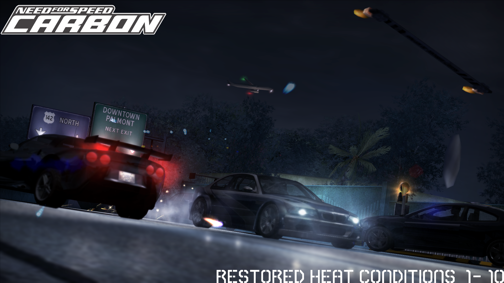

# NFSC_RestoreHeatConditions

A mod for `Carbon` that restores the `unused heat level radio calls` for heat 6, 7, 8, 9 and 10.

## Restores

- `Heat 6, 7, 8, 9 and 10 radio calls.` When your heat jumps to one of those levels, dispatch or a cop calls it out on the radio, just like the vanilla calls for heat 2 to 5. The lines were recorded for the game but never played and left in the COPSPEECH files, because the game only knew about heat 2 to 5.

## Requirements

- Need for Speed: Carbon, PC version 1.4.
- Ultimate ASI Loader.
- A mod that lets your heat go above 5, since the vanilla game stops at heat 5 (For example, ExOpts).

## Installation

1. Copy `scripts` into your game directory, and launch the game.

2. Go into a game, and start at heat 6, then the speech line should play.

To uninstall, go to `scripts` and delete `NFSC_RestoreHeatConditions.asi`.

## Credits

- `Eatincrispies` (Mod creator)
- `Roskler` (Mod Tester.)
